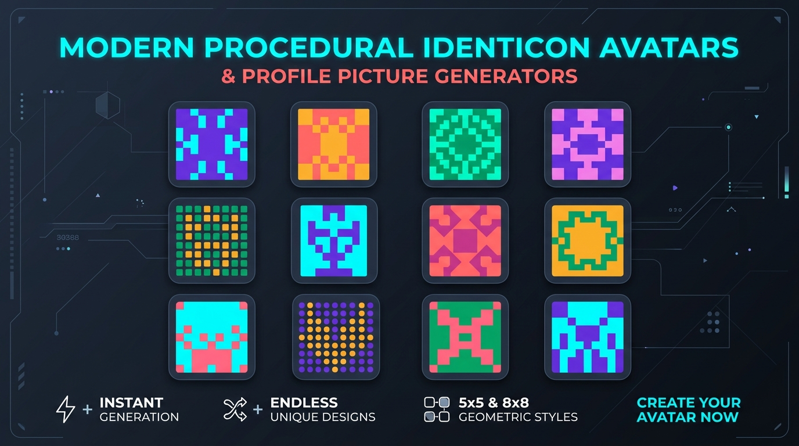
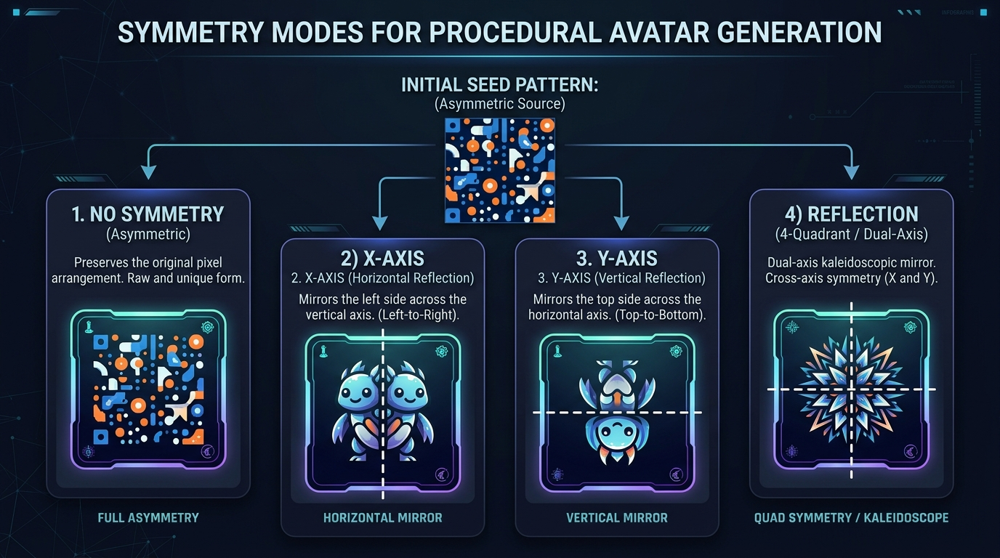
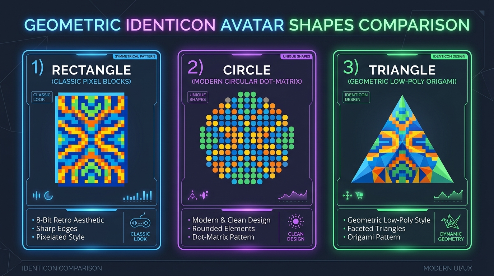
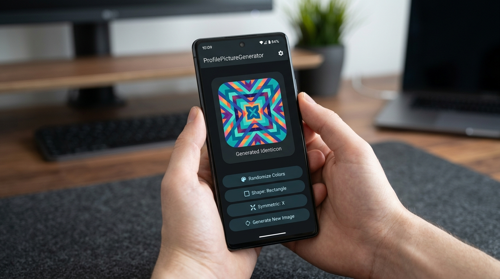

# ProfilePictureGenerator 🎨

[](https://developer.android.com)
[](https://kotlinlang.org)
[](#)
[](#)
[](#)

A high-performance, procedural identicon and profile picture avatar generator for Android. Create beautiful, deterministic geometric avatars—like GitHub and GitLab identicons—with complete control over multi-axis symmetry, tile shapes, palettes, and output resolution.

---



---

## ✨ Features

- 🔐 **Deterministic Avatars**: Hash any username, user ID, email, or seed into a unique, persistent profile picture.
- 🪞 **Multi-Axis Symmetry**:
  - `Symmetric.X` – Classic GitHub/GitLab horizontal mirror across the vertical center line (left mirrors to right).
  - `Symmetric.Y` – Vertical mirror across the horizontal center line (top mirrors to bottom).
  - `Symmetric.REFLECTION` – Dual-axis 4-quadrant kaleidoscopic reflection.
  - `Symmetric.NONE` – Free-form asymmetric randomized pixel art.
- 🔷 **Geometric Unit Shapes**:
  - `SingleShape.Rectangle` – Retro 8-bit / pixel-art square tiles.
  - `SingleShape.Circle` – Sleek, modern dot-matrix circular tiles with anti-aliasing.
  - `SingleShape.Triangle` – Contemporary low-poly geometric triangular facets.
- 🎨 **Dynamic Color Theming**:
  - Feed your app's brand colors or custom palettes.
  - Re-skin colors instantly on the fly with `updateColor()` without altering the layout geometry.
- ⚡ **Lightweight & Sub-Millisecond Rendering**: Direct hardware-accelerated `Canvas` rendering to Android `Bitmap` without any heavy third-party dependencies.
- 📐 **Fully Configurable**: Customizable grid divisions (`5x5`, `6x6`, `12x12`, etc.) and output bitmap sizes (`128x128`, `512x512`, `1024x1024`).
- 🌟 **Transparent & Custom Backgrounds**: Generate transparent PNGs/Bitmaps or render solid background cards.

---

## 🖼️ Visual Showcase

### 1. Multi-Axis Symmetry

Symmetry defines how the procedural seed tiles are mirrored across the canvas. With bug-free bounds checking and center-line coordinate mapping, both odd-sized grids (e.g., 5×5) and even-sized grids (e.g., 12×12) mirror cleanly:



| Mode | Axis of Mirroring | Visual Effect | Best For |
|---|---|---|---|
| **`Symmetric.X`** | Vertical centerline | Left half is mirrored to right half | Classic GitHub/GitLab identicons, avatars, user badges |
| **`Symmetric.Y`** | Horizontal centerline | Top half is mirrored to bottom half | Totem / reflection artwork, futuristic insignias |
| **`Symmetric.REFLECTION`** | Both X and Y centerlines | 4-Quadrant dual-axis reflection | Mandalas, emblems, shields, kaleidoscopic logos |
| **`Symmetric.NONE`** | None | No mirroring (all cells independent) | Abstract pixel mosaics, retro 8-bit textures |

---

### 2. Geometric Shape Styles

Customize the look and feel of the identicon by choosing between crisp rectangular pixels, smooth anti-aliased circular dots, or geometric triangles:



---

### 3. Interactive Sample Application

The repository includes a runnable sample app (`app`) demonstrating live property updates:



---

## 📦 Installation

Add the library module to your project:

```groovy
dependencies {
    implementation project(':profilepicturegenerator')
}
```

*Or via JitPack (when published):*
```groovy
repositories {
    maven { url 'https://jitpack.io' }
}

dependencies {
    implementation 'com.github.Username:ProfilePictureGenerator:1.0.0'
}
```

---

## 🚀 Quick Start

### 1. One-Liner Avatar Generation

Generate a ready-to-display `Bitmap` in a single function call:

```kotlin
import de.hartz.software.profilepicturegenerator.PictureGenerator
import de.hartz.software.profilepicturegenerator.SingleShape
import de.hartz.software.profilepicturegenerator.Symmetric

// Generate a classic 5x5 GitHub-style identicon for a user
val avatarBitmap = PictureGenerator.create(
    width = 5,
    height = 5,
    shape = SingleShape.Rectangle,
    symmetric = Symmetric.X,
    seed = "user@example.com",
    outputSize = 512
)

imageView.setImageBitmap(avatarBitmap)
```

---

### 2. Full Customization with `PictureInstance`

For fine-grained control over colors, background, and grid properties:

```kotlin
import android.graphics.Color
import de.hartz.software.profilepicturegenerator.PictureGenerator
import de.hartz.software.profilepicturegenerator.SingleShape
import de.hartz.software.profilepicturegenerator.Symmetric

// 1. Create a configured generator instance
val generator = PictureGenerator.generate(
    width = 6,
    height = 6,
    colors = intArrayOf(
        Color.rgb(33, 150, 243),  // Material Blue
        Color.rgb(233, 30, 99),   // Material Pink
        Color.rgb(0, 150, 136)    // Material Teal
    ),
    maxColors = 2,
    shape = SingleShape.Circle,
    symmetric = Symmetric.REFLECTION
)

// 2. Configure additional attributes
generator.seed = user.id.toString()
generator.outputWidth = 256
generator.outputHeight = 256
generator.backgroundColor = Color.WHITE

// 3. Render Bitmap
val bitmap = generator.createNew()
imageView.setImageBitmap(bitmap)
```

---

### 3. Dynamic Color Re-Skinning

Change the color palette on the fly without recomputing the layout pattern:

```kotlin
// Pick new colors
generator.colors = intArrayOf(Color.MAGENTA, Color.CYAN, Color.YELLOW)

// Updates tile colors while preserving the original shape matrix
generator.updateColor()

// Render the updated image
imageView.setImageBitmap(generator.generate())
```

---

### 4. Deterministic User Avatars from Email or UUID

Guarantees the user always receives the exact same profile picture across device reboots and app launches:

```kotlin
fun getAvatarForUser(email: String): Bitmap {
    val brandColors = intArrayOf(
        Color.parseColor("#4A90E2"),
        Color.parseColor("#50E3C2"),
        Color.parseColor("#B8E986"),
        Color.parseColor("#FF5A5F")
    )
    return PictureGenerator.create(
        width = 5,
        height = 5,
        colors = brandColors,
        maxColors = 2,
        shape = SingleShape.Rectangle,
        symmetric = Symmetric.X,
        seed = email.trim().toLowerCase(),
        outputSize = 256
    )
}
```

---

## 📖 API Reference

### `PictureGenerator` (Object)

| Method | Return Type | Description |
|---|---|---|
| `create(width, height, colors, maxColors, shape, symmetric, seed, outputSize)` | `Bitmap` | Convenience method to generate and return a `Bitmap` in one step. |
| `generate(width, height, colors, maxColors, shape, symmetric)` | `PictureInstance` | Creates a new configured generator instance. |
| `generate(width, height, colors, maxColors, shape, symmetric, seed)` | `PictureInstance` | Creates a new configured generator instance with a custom seed. |
| `generateSample()` | `Bitmap` | Returns a sample 14×14 identicon bitmap. |

### `PictureInstance` (Class)

| Property / Method | Type | Default | Description |
|---|---|---|---|
| `width` | `Int` | `12` | Number of columns in the tile grid. |
| `height` | `Int` | `12` | Number of rows in the tile grid. |
| `colors` | `IntArray` | `[CYAN, RED]` | Array of `@ColorInt` values to sample from. |
| `maxColors` | `Int` | `2` | Maximum number of active colors picked from palette. |
| `singleShape` | `SingleShape` | `Rectangle` | Tile shape: `Rectangle`, `Circle`, or `Triangle`. |
| `symmetric` | `Symmetric` | `NONE` | Mirroring mode: `X`, `Y`, `REFLECTION`, or `NONE`. |
| `seed` | `String` | Random UUID | Procedural seed string for layout and colors. |
| `outputWidth` | `Int` | `512` | Output bitmap width in pixels. |
| `outputHeight` | `Int` | `512` | Output bitmap height in pixels. |
| `backgroundColor` | `Int` | `Color.TRANSPARENT` | Canvas background color. |
| `createNew(): Bitmap` | `Bitmap` | — | Computes a new template matrix and returns the rendered `Bitmap`. |
| `generate(): Bitmap` | `Bitmap` | — | Renders the bitmap (computes template if not yet initialized). |
| `updateColor()` | `Unit` | — | Re-randomizes tile colors from palette without altering layout. |
| `getMirroredCoordinates(x, y)` | `Pair<Int, Int>` | — | Returns the mirrored source coordinates for grid point `(x, y)`. |

---

## 🧪 Unit Testing

The repository contains unit tests covering:
- Correct coordinate mirroring across odd and even dimensions for `Symmetric.X`, `Symmetric.Y`, `Symmetric.REFLECTION`, and `Symmetric.NONE`.
- Out-of-bounds safety and non-crashing bounds coercion.
- Matrix dimensions stability during consecutive `updateColor()` calls.

To run tests:
```bash
./gradlew :profilepicturegenerator:testDebugUnitTest
```

---

## 🤝 Contributing

Contributions, issues, and feature requests are welcome!
Feel free to open an issue or submit a pull request.

1. Fork the Project
2. Create your Feature Branch (`git checkout -b feature/AmazingFeature`)
3. Commit your Changes (`git commit -m 'Add some AmazingFeature'`)
4. Push to the Branch (`git push origin feature/AmazingFeature`)
5. Open a Pull Request

---

## 📄 License

Distributed under the Apache 2.0 License. See `LICENSE` for more information.
